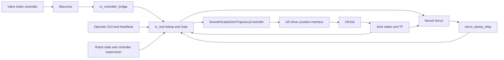

> **Operator workflow:** Open the app → **START TELEOP** → wait for **READY — PRESS A TO MOVE** → hold A. Release A to stop; **STOP TELEOP** disarms. When the approved External Control `.urp` is configured, START TELEOP also checks Remote Control, loads/plays it through the UR Dashboard services, and waits for confirmed driver readiness. An existing configured workcell needs no wizard or historical evidence file. Configuration integrity and live robot protections still apply. New or modified workcells require physical validation before operation. See [sway recording and offline analysis](docs/SWAY_DIAGNOSTICS.md).

# UR10e Valve Index teleoperation

This project maps a Valve Index controller's translation and rotation to a Universal Robots UR10e through ROS 2 Humble. A desktop panel manages tracking, robot connection, commissioning checks, and an A-button clutch. It is an engineering teleoperation application with software safeguards; deployment still requires supervised hardware commissioning.

The current implementation supports **either one or two calibrated Lighthouse stations**. One recent accepted paired optical sensor observation establishes signal presence. Motion separately requires a fresh, valid, continuous 6-DoF pose. Single-station operation needs no experimental selection and applies no extra speed multiplier. Cold-start tracking with one physical station still needs installation-specific verification.

## Capabilities and status

- Velocity mode (built-in/YAML default): hand motion produces bounded Cartesian velocity; stationary hand motion produces zero demand.
- Position mode (committed saved override): a clutch-relative pose target is followed with bounded Cartesian velocity. Determine the actual session mode from effective runtime settings.
- Configurable tool-tip rotation centre with disarmed pendant TCP import; see [tool-tip setup](docs/OPERATION.md#change-the-tool-tip--rotation-centre).
- Translation and rotation mapping, pose filters, spatial deadbands, configurable speed and acceleration limits.
- Hold A to command; release to stop. Tracking faults invalidate the clutch and require release and a new press.
- MoveIt Servo, collision/singularity monitoring, and a custom Ruckig controller upstream of the UR driver's position interface.
- A single-window operator dashboard with persistent tuning, session diagnostics, RViz, and an optional D405 wrist-camera display.
- Driver-connected Preview and a separate hardware-free mock simulator. These exercise different control paths.

**Review active settings before commissioning.** The committed YAML specifies 0.10 m/s linear speed; the committed saved operator profile overrides it to **0.5 m/s**. Angular speed is overridden from 30 to **60 deg/s**, joint speed from 0.5 to **1.5 rad/s**, and alignment yaw from −90° to **−45°**. The saved profile also selects Position while the built-in/YAML mode is Velocity. These are existing settings, not recommended starting limits. See [configuration precedence](docs/CONFIGURATION.md#configuration-precedence).

## System architecture



The Cartesian command goes through Servo; the resulting joint trajectory returns through a timestamp relay and the gate before reaching the final controller. There is no direct `speedl`/`speedj` teleoperation path. Valve Index tracking is shared, but the gripper has a separate authorization, pickup and ST3215 serial path that does not depend on A, Servo, arm motion readiness or External Control. Dashboard program management controls the approved External Control program; it does not send real-time Cartesian commands. [Architecture and ROS interfaces](docs/ARCHITECTURE.md) describes responsibilities and stop behavior.

## Requirements and installation

The supported environment is Ubuntu 22.04 with ROS 2 Humble and system Python 3.10. Hardware consists of the configured UR10e, a paired Valve Index controller/receiver, at least one calibrated Lighthouse, and optionally a RealSense D405. The robot needs External Control configured for the workstation's reachable IP. The committed robot address is `192.168.1.251`; the workstation address is site-specific.

Dependencies include the ROS UR driver, MoveIt Servo, ros2_control, Ruckig, libsurvive, NumPy/SciPy/YAML, Tk/Pillow, and the librealsense2 development SDK. The camera is optional at runtime, but its package requires the SDK to build. The project contains machine-specific serials, paths, and a robot calibration-hash check.

Follow [Installation](docs/INSTALLATION.md) for complete fresh-system commands, pinned upstream dependencies, build instructions, and verification. Start the checkout with:

```bash
mkdir -p ~/Documents
cd ~/Documents
git clone https://github.com/stefanoKS/UR_TeleOP_Index.git Teleop
cd Teleop
```

Do not run the application until dependencies are built and the hardware-specific configuration has been reviewed. A fresh installation on a second machine has not been reproduced as part of this documentation work.

## Quick start

After installation, use the existing **UR10e Teleop** desktop shortcut, if installed on this workstation, or:

```bash
~/Documents/Teleop/ur_teleop/start_teleop.sh
```

1. The managed desktop starts **Live, motion disarmed**, with the motion controller inactive.
2. Press **START TELEOP** once with A released. No wizard opens automatically and no `verified_setup.json` or historical evidence file is required. A new or physically changed workcell still requires site commissioning and supervised validation before routine operation.
3. Automatic Dashboard program start occurs only when `dashboard.remote_program_control_enabled` is configured, the approved `.urp` identity is set, and the robot is in Remote Control with the required readiness conditions. The app checks, loads/plays as needed, and waits for Dashboard running plus fresh driver readback. Otherwise start the approved External Control program through the pendant workflow. Then wait for **READY — PRESS A TO MOVE**.
4. Hold A to move; release A to request a controlled stop.
5. Press **STOP TELEOP** to clear arm enable intent. **STOP GRIPPER** is separate. **STOP ALL** withdraws both. Closing the app requests a Dashboard program stop before the UR driver is terminated. Engineering Preview and the old supervised workflow remain under explicit engineering controls; see [Operation](docs/OPERATION.md).


For tracking alone, without starting the driver or teleoperation:

```bash
source /opt/ros/humble/setup.bash
source ~/Documents/Teleop/ur_teleop_ws/install/local_setup.bash
export ROS_DOMAIN_ID=43
ros2 run ur_vr_bridge controller_bridge
```

Do not start a second bridge alongside the managed desktop. `start_gui.sh` opens only the panel and does not manage the stack. See [Operation](docs/OPERATION.md).

## Testing

With no production stack running, use an isolated local ROS domain:

```bash
cd ~/Documents/Teleop
source /opt/ros/humble/setup.bash
source ur_teleop_ws/install/local_setup.bash
export ROS_LOCALHOST_ONLY=1 ROS_DOMAIN_ID=147
/usr/bin/python3 -m pytest ur_teleop_ws/src/ur_vr_teleop/test ur_teleop_ws/src/ur_vr_sim_teleop/test -q
/usr/bin/python3 -m pytest ur_teleop_ws/src/ur_vr_teleop/test/ros_integration_checks.py -q
/usr/bin/python3 ur_teleop_ws/src/ur_vr_teleop/test/program_dashboard_check.py
ctest --test-dir ur_teleop_ws/build/ur_vr_bridge --output-on-failure
ctest --test-dir ur_teleop_ws/build/ur_teleop_controllers --output-on-failure
```

For the separate mock simulator:

```bash
ROS_DOMAIN_ID=42 ros2 launch ur_vr_sim_teleop simulation.launch.py
```

It uses `mock_components/GenericSystem`, prefixed simulated joints, and starts with motion disabled. It does not reproduce the production Ruckig/gate chain. [Commissioning](docs/COMMISSIONING.md#automated-validation) lists additional mock and Servo checks and explains their limits.

## Troubleshooting

| Symptom | Start here |
|---|---|
| One station, no pose, stale/frozen tracking | [Tracking](docs/TROUBLESHOOTING.md#tracking) |
| A or Enable does not produce motion | [Readiness](docs/TROUBLESHOOTING.md#readiness-and-stops) |
| Wrong speed, lag, sway | [Settings and motion](docs/TROUBLESHOOTING.md#settings-and-motion) |
| Launch/build/ROS discovery failure | [Installation and processes](docs/TROUBLESHOOTING.md#installation-and-processes) |

## Repository map

| Path | Purpose |
|---|---|
| `ur_teleop_ws/src/ur_vr_bridge/` | libsurvive bridge, optical/pose guards, timestamp relay |
| `ur_teleop_ws/src/ur_vr_teleop/` | Cartesian control, gate, GUI, desktop supervisor, diagnostics |
| `ur_teleop_ws/src/ur_teleop_controllers/` | Native Ruckig/UR scaled controller plugin |
| `ur_teleop_ws/src/ur_vr_sim_teleop/` | Separate legacy mock simulation |
| `ur_teleop_ws/src/ur_d405_camera/` | Isolated camera capture helper and ROS publisher |
| `ur_teleop/config/` | Robot calibration, YAML defaults, saved operator preferences |
| `ur_teleop/scripts/` | Recording, analysis, real-time permission helper |
| `dependencies.repos` | Exact libsurvive and calibration-driver revisions |
| `ur_calibration_fix_ws/` | Calibration-only overlay and historical status notes |

The active ROS workspace is `ur_teleop_ws`; the old duplicate runtime build was archived during migration. Standard UR packages come from ROS packages; only `ur_calibration` is built in the calibration overlay. Generated builds, logs, recordings, backups, and upstream checkouts are ignored by Git. Keep source, runtime configuration, scripts, and dependency pins under version control; ignore rules do not apply to manual browser uploads.

## Documentation

- [Architecture](docs/ARCHITECTURE.md), [Installation](docs/INSTALLATION.md), [Operation](docs/OPERATION.md)
- [Configuration](docs/CONFIGURATION.md), [Commissioning](docs/COMMISSIONING.md), [Troubleshooting](docs/TROUBLESHOOTING.md)
- [AI agent engineering rules](AGENTS.md)

Historical design/session records are retained: [V2 notes](ur_teleop/TELEOP_V2.md), [teleop update](ur_teleop/TELEOP_UPDATE_20260924.md), [damping](ur_teleop/DAMPING_UPDATE_20260924.md), [state and camera](ur_teleop/DIRECT_STATE_AND_D405_20260924.md), [joint smoothing](ur_teleop/FINAL_COMMAND_SMOOTHING.md), [motion review](ur_teleop/SMOOTH_MOTION_REVIEW.md), and [old project status](ur_calibration_fix_ws/PROJECT_STATUS.md). They describe earlier states and may contain obsolete paths, two-station requirements, or limits. Current source and the guides above take precedence.

Dashboard status fields and parameter synchronization are documented in the [operator-status contract](docs/OPERATOR_STATUS.md).

[V4 implementation, validation, screenshots and rollback](docs/V4_STARTUP_REPORT.md).

[V6 independent gripper, Dashboard program start and ordered shutdown](docs/V6_INDEPENDENCE_REPORT.md).

[V6.1 stop-dominant authorization, shared tracking and verification stabilization](docs/V6_1_STABILIZATION_REPORT.md).

[Optional commissioning observations and historical setup records](docs/INITIAL_SETUP.md).

## Optional rack gripper

A separate single-ST3215 subsystem maps the Index analog trigger to saved OPEN/CLOSED encoder endpoints. A remains the arm clutch. The gripper has its own session enable, heartbeat and stop controls: **ENABLE GRIPPER** / **STOP GRIPPER** work before START TELEOP, with A released or held, and while the UR driver or External Control program is unavailable. Connect and read diagnostics without a robot connection. Start with [Gripper setup, SDK installation and validation](docs/GRIPPER.md); the unconfigured gripper is disabled and does not block arm-only operation.
