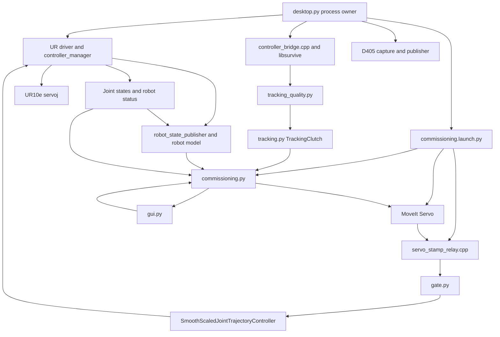
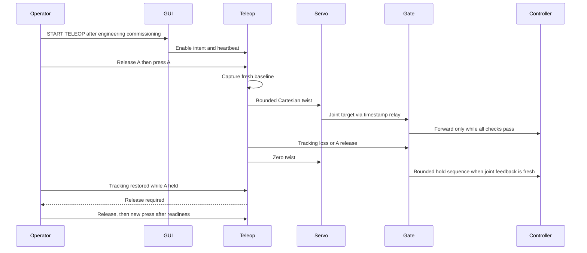

# Architecture

This guide describes the source at revision `c7373d9` plus the documentation update. It describes implemented behavior, not certification or proof of physical performance. See [configuration](CONFIGURATION.md) for values and [commissioning](COMMISSIONING.md) for validation boundaries.

## Processes and responsibilities

`desktop.py` owns child process groups, session logs, and configuration snapshots. It does not implement the control algorithm. `Commissioning` inherits the observation/TF handling in `Preview`, owns `TrackingClutch` and `Gate`, publishes Cartesian commands, and forwards accepted joint commands. `gate.py` validates joint trajectories and readiness separately from the Cartesian controller.

The managed stack uses ROS domain **43**, wall time, `/vr_real` for commissioning nodes, and the driver/controller manager at the root namespace. The bridge node is `/vr_controller_bridge`; commissioning is `/vr_real/teleop`; Servo is `/vr_real/servo_node`; the relay is `/vr_real/servo_stamp_relay`; the GUI is `/vr_real/teleop_operator_gui`.

## Tracking and coordinates

`controller_bridge.cpp` embeds the pinned libsurvive library. It selects `device_name` or the requested serial, drains up to 2048 events per 10 ms tick, and publishes the newest accepted pose. It preserves source timing through a fixed source-to-ROS timestamp anchor. It does not refresh a pose merely because an IMU event or timer tick occurred.

The bridge checks finite coordinates, quaternion norm, and increasing source time. libsurvive quaternion order is **w,x,y,z**; ROS messages use **x,y,z,w**. ROS poses use `lighthouse`; the bridge broadcasts `lighthouse → vr_controller`. The teleoperation mapping rotates tracking motion into `base_link`; measured TCP feedback is `base_link → tool0` by default, or `base_link → teleop_tcp` with a saved tool offset. An arbitrary pendant TCP or camera mount is not automatically equivalent to `tool0`.

`optical_guard.hpp` accepts calibrated Gen2 paired plane observations. Either station needs at least one accepted sensor pair within **0.25 s**. Duplicated/reordered samples do not refresh it. There is no four-sensor-per-station requirement and no station-count speed penalty. `two_station_strict` and `single_station_experimental` are compatibility aliases for `any_station`.

Signal presence is only one input. `tracking_quality.py` also rejects nonfinite poses, stale/non-increasing timestamps, jumps above **0.05 m or 45°**, excessive pose gaps, and exact pose freezing beyond **0.5 s**. Recovery needs at least three continuous poses spanning **0.1 s**. Commissioning additionally checks fresh optical diagnostics and stable signal for **0.5 s**. Losing one station does not itself invalidate a continuing valid pose from the other.

The inspected libsurvive revision can seed from one station and solve against available calibrated stations; it does not require both station IDs. Its solver still needs sufficient independent measurements (MPFIT checks eight measurements and both sweep axes). A single paired observation cannot establish a geometrically reliable pose. Local libsurvive calibration is outside Git, in `~/.config/libsurvive/config.json`; preserve its station poses and the downstream mapping. One-station cold start remains a hardware validation item.

## Cartesian modes and clutch

`tracking.py` uses the simulation core's pose/quaternion utilities but adds real-path quality and velocity behavior. Standalone `TrackingClutch` retains a position-mode API default; commissioning explicitly selects its configured mode, normally **velocity**.

| Stage | Position mode | Velocity mode |
|---|---|---|
| Reference | Hand and measured TCP pose captured on fresh clutch press | Hand sample baseline captured on fresh clutch press; first demand is zero |
| Mapping | Scaled relative displacement and rotation become TCP target | Mapped displacement/orientation increments divided by source-time interval |
| Pose conditioning | New-sample position/quaternion filters and deadbands | Same filters, continuous spatial deadband, timestamp-aware differentiation |
| Cartesian demand | Pose error times `tracking_gain_s_inv`; optional measured-tool velocity damping | Hand linear/angular velocity times mapping scales; time-based velocity filters |
| Bounds | Linear/angular norm speed limits and acceleration slew | Same bounds; no extra position-error tracking gain or measured-tool damping |

Velocity differentiation runs only for distinct source samples, accepts intervals **1–100 ms**, and uses relative quaternion rotation in the world frame for angular velocity. Timer repetitions do not create new velocity estimates. After **30 ms** without a new sample, demand decays normally; at **100 ms**, the velocity path faults and clears its baseline. These thresholds are distinct from the general 0.35 s observation timeout. Control-step slew uses a capped time step.

Clutch states require a healthy released A button before a new press can enter active control. A is Joy button index **4**. Release, invalid tracking, or a gate fault resets the reference. Restoring tracking while A remains held cannot resume motion.

## Servo, joint gate, and final actuator reference

Commissioning emits `TwistStamped` at **100 Hz** in `base_link`. MoveIt Servo converts it to six-joint `JointTrajectory` position and velocity targets at **100 Hz**; acceleration output is disabled. The model includes UR kinematic calibration, semantic group `ur10e_manipulator`, joint limits, collision checks, and singularity handling.

Production selects `ur_teleop_controllers::ServoVelocityPassthrough` for Servo's smoothing interface. Humble Servo derives output velocity from `(position_target - measured_position) / publish_period`; filtering absolute position targets here feeds lagged measured motion back into that velocity. The plugin leaves finite six-joint position targets unchanged, so Servo's collision/singularity-scaled joint increment determines velocity. Cartesian filtering remains upstream and final joint velocity/acceleration/jerk limiting remains in native Ruckig. No extra velocity filter or feedback correction is introduced. This plugin is for the supervised native controller chain; the separate simulator retains its existing configuration. Invalid plugin input stops Servo rather than silently passing it through.

The relay preserves an existing header timestamp or uses the DDS source timestamp for an unstamped message. It does not make old data fresh by stamping receipt time. The gate checks source order/age, finite values, exact joint membership, horizon **0.005–0.10 s**, and command age below **0.10 s**. Before-clutch buffered commands are rejected. With verified native smoothing, requested joint position lead is bounded at **0.05 rad**; without it the conservative speed/time envelope applies. Supplied velocities/accelerations are also checked.

Only a commissioning node launched with `motion_output_enabled=true` creates the publisher to `/scaled_joint_trajectory_controller/joint_trajectory`. The gate requires unique expected publishers and no active competing trajectory action. Do not add another joint publisher to this pipeline.

The plugin `ur_teleop_controllers/SmoothScaledJointTrajectoryController` extends the UR scaled trajectory controller. Its nominal **500 Hz** update writes a Ruckig-limited position reference to the UR driver's position command interfaces. Ruckig uses velocity control and independent joint synchronization (`None`). When Servo velocities are provided, they are the velocity demand; there is no second position-error loop on top. A legacy position-only target uses feedforward plus bounded position feedback. This fallback is not the production Servo configuration.

Native velocity, acceleration, jerk, following-error, period, and finite-state checks are independent of Cartesian limits. Speed scaling constrains demand. Activation requires near standstill. A hard controller error restores the previous write and returns an error; do not interpret normal Ruckig bounds as a guarantee about an emergency or deactivated controller. The UR driver sends the resulting positions through its existing `servoj` path. No custom socket robot-control implementation is added.

## Supervision and stopping

Readiness combines tracking/TF/joint freshness, robot RUNNING state, safety NORMAL or REDUCED state, External Control program running, nonzero speed scaling, Servo state, controller ownership, command watchdog verification, GUI heartbeat, and current configuration integrity (explicit mapping, calibrated robot model, frames and typed tuning). REDUCED does not disable the robot's independent limits. Servo codes 2, 4, and 5 block motion; permitted codes 0, 1, 3, and 6 retain Servo's corresponding behavior. Unknown or stale status blocks.

Servo status carries an explicit lifecycle rather than a permanent historical flag. The backend reports `servo_process_present` (the `status` publisher exists; the process is up even before it is started), `servo_status_seen` (a status has arrived this session) and `servo_status_fresh` (received within 250 ms — MoveIt Servo publishes at `1/publish_period`, about 100 Hz, only after `start_servo` runs its loop). `servo_state` is `absent`, `unstarted`, `running`, `stale` or `stopped`. A stale status is never healthy; the startup coordinator attempts at most one bounded restart before reporting the exact Restart ROS instruction. See [status contract](OPERATOR_STATUS.md#v4-authoritative-readiness-and-coordinator).

Controller discovery must show the scaled controller as the sole position claimant in live operation. Dry-run expects motion controllers inactive. The configured controller command watchdog must be in the accepted **0.10–0.25 s** interval, with `constraints.goal_time` below it. Listing and parameter checks are not replaced by a GUI label.

A fault clears the active reference, commands zero upstream, and requests measured-position holds with zero velocity for **0.20 s** when joint feedback is usable. Downstream smoothing performs normal deceleration; software Disarm is not an emergency stop. Stale feedback can prevent a new measured hold, so command watchdogs remain essential.

Enable intent can survive some faults. After release, healthy conditions, and **0.5 s** of stationary recovery, the system can rearm, but a fresh clutch press is still required. GUI Disarm or lost operator heartbeat clears enable intent. Do not describe recovery as automatic motion or claim every fault requires a new Enable click.

## ROS interfaces

Rates are configured timer/output targets, not measured timing guarantees. Names below assume the managed launch; ROS namespace/remapping changes require coordinated review.

| Topic | Type | Producer → consumer; nominal rate |
|---|---|---|
| `/vr/controller/pose` | `geometry_msgs/PoseStamped` | Bridge → teleop; new accepted samples, up to 100 Hz |
| `/vr/controller/joy` | `sensor_msgs/Joy` | Bridge → teleop/GUI; 100 Hz, A at buttons[4] |
| `/vr/controller/pose_fresh` | `std_msgs/Bool` | Bridge freshness diagnostic; 100 Hz |
| `/vr/controller/optical_fresh` | `std_msgs/Bool` | Bridge → commissioning; 100 Hz |
| `/vr/controller/optical_status` | `std_msgs/String` | Per-station paired-sensor diagnostic → commissioning; 100 Hz |
| `/vr/controller/source_time` | `std_msgs/Float64` | Bridge source time, on accepted pose |
| `/vr/controller/device` | `std_msgs/String` | Selected identity; transient-local |
| `/joint_states` | `sensor_msgs/JointState` | Driver → model/teleop/Servo; driver rate, best-effort subscription |
| `/tf`, `/tf_static` | `tf2_msgs/TFMessage` | Tracking and robot frames; dynamic/static TF |
| `/vr_real/servo_node/delta_twist_cmds` | `geometry_msgs/TwistStamped` | Teleop → Servo; 100 Hz |
| `/vr_real/servo_unstamped_targets` | `trajectory_msgs/JointTrajectory` | Servo → relay; 100 Hz |
| `/vr_real/servo_joint_targets` | `trajectory_msgs/JointTrajectory` | Relay → gate; corresponding samples |
| `/scaled_joint_trajectory_controller/joint_trajectory` | `trajectory_msgs/JointTrajectory` | Gate → native controller; live only, 100 Hz maximum normal forwarding |
| `/scaled_joint_trajectory_controller/smoothed_command` | `trajectory_msgs/JointTrajectory` | Native reference monitor; 100 Hz nominal |
| `/scaled_joint_trajectory_controller/control_diagnostics` | `std_msgs/Float64MultiArray` | Native measured/Servo/Ruckig diagnostics; 10 Hz nominal |
| `/scaled_joint_trajectory_controller/controller_state` | `control_msgs/JointTrajectoryControllerState` | Base controller state → diagnostic tools; configured 100 Hz |
| `/vr_real/servo_node/status` | `std_msgs/Int8` | Servo → readiness gate |
| `/speed_scaling_state_broadcaster/speed_scaling` | `std_msgs/Float64` | Driver percentage → gate (divided by 100); configured 100 Hz |
| `/io_and_status_controller/robot_mode` | `ur_dashboard_msgs/RobotMode` | Driver → gate |
| `/io_and_status_controller/safety_mode` | `ur_dashboard_msgs/SafetyMode` | Driver → gate |
| `/io_and_status_controller/robot_program_running` | `std_msgs/Bool` | Driver → gate; transient-local subscription |
| `/scaled_joint_trajectory_controller/follow_joint_trajectory/_action/status` | `action_msgs/GoalStatusArray` | Action status → gate; accepted/executing/canceling goals block |
| `/vr_real/operator_present` | `std_msgs/Bool` | GUI heartbeat → gate; 10 Hz, 0.5 s deadline |
| `/vr_real/operator_status` | `std_msgs/String` | Teleop JSON status/settings → GUI; 100 Hz |
| `/vr_real/armed` | `std_msgs/Bool` | Teleop readiness state; 100 Hz |
| `/vr_real/preview_state` | `std_msgs/String` | Teleop textual diagnostics; 100 Hz commissioning / 50 Hz standalone preview |
| `/vr_real/preview_markers` | `visualization_msgs/MarkerArray` | Preview target and measured markers, same timer |
| `/wrist_camera/color/image_raw`, `/wrist_camera/depth/image_raw` | `sensor_msgs/Image` | Camera → viewer; 640×480, 15 fps, RGB8 / 32FC1 metres |
| `/wrist_camera/color/camera_info`, `/wrist_camera/depth/camera_info` | `sensor_msgs/CameraInfo` | Camera intrinsics, per image |
| `/wrist_camera/status` | `std_msgs/String` | Camera availability; transient-local |

| Service | Type | Role |
|---|---|---|
| `/vr_real/arm`, `/vr_real/disarm` | `std_srvs/srv/Trigger` | Explicit gate requests |
| `/vr_real/set_enabled` | `std_srvs/srv/SetBool` | Persistent enable intent / disarm |
| `/vr_real/teleop/set_parameters_atomically` | `rcl_interfaces/srv/SetParametersAtomically` | GUI applies settings and session confirmations together |
| `/vr_real/servo_node/start_servo` | `std_srvs/srv/Trigger` | Start solver; does not enable robot motion |
| `/controller_manager/list_controllers` | `controller_manager_msgs/srv/ListControllers` | Ownership/readiness polling |
| `/controller_manager/switch_controller` | `controller_manager_msgs/srv/SwitchController` | GUI startup coordinator requests scaled controller activation; does not stop a competitor |
| `/scaled_joint_trajectory_controller/get_parameters` | `rcl_interfaces/srv/GetParameters` | Verify watchdog and native smoothing parameters |

The standard controller exposes `control_msgs/action/FollowJointTrajectory`; teleop does not send action goals. ROS parameter services and other standard UR/MoveIt interfaces also exist; this table covers the application control/diagnostic contract, not every interface of external packages.

## Other paths

The D405 uses a C++ librealsense capture child and Python ROS publisher, isolated from robot control. Its mount transform is not calibrated, and the image is not collision protection. Disconnects trigger retries without stopping robot ROS nodes.

The domain-42 `ur_vr_sim_teleop` launch uses `GenericSystem`, `sim_` joints, a forward position controller, 100 Hz Servo, and the original 50 Hz position clutch. It rejects a non-mock URDF and starts motion disabled. It does not test the native real-path smoother or all commissioning checks. Mock integration tests separately exercise the production gate and Servo path on localhost domains 147/148.

Dashboard status fields and parameter synchronization are documented in the [operator-status contract](OPERATOR_STATUS.md).

The asynchronous `Startup` coordinator uses backend `configuration_ready` plus live readiness. Background `Configuration` checks the effective installation inputs in commissioning. It uses existing services and no additional command publisher. Desktop defaults to Live disarmed; Preview remains explicit. See [status contract](OPERATOR_STATUS.md#v4-authoritative-readiness-and-coordinator) and [optional historical evidence](COMMISSIONING.md#v4-engineering-record).

## Initial Setup Wizard

The former mandatory wizard is now an optional engineering observation tool. It never opens automatically and historical results never grant readiness. `setup_checks.py`, `calibration_capture.py` and its read-only observer retain their observation/isolation rules. Physical tests still require explicit supervision.

`configuration.py` checks the effective snapshot and current parameters on a background worker. `verified_setup.json`, expiry, eleven test results and source identity are absent from the runtime readiness path. Source compatibility exceptions for old evidence remain narrow and unchanged. The native limits check still compares actual controller readback with the startup configuration.

The diagnostics recorder is a separate owned process that only runs bag recording and parameter reads. The offline analyzer instantiates no ROS node. Neither can enable motion. See [sway diagnostics](SWAY_DIAGNOSTICS.md).

## Controller-driven Preview calibration

The [V5.1 observer](CALIBRATION_V51.md) has a dedicated ROS node/executor thread, separate from the GUI's single-callback polling. It reads tracking and independent Preview-isolation evidence, then feeds a pure bounded capture engine. A one-entry cumulative-result mailbox and bounded command queue separate ROS from Tk. It has no motion publisher, enable client or controller-switch client. Its only service clients read parameters and controller state, while capture is permitted. Closing the wizard joins the executor and destroys its node; reopening creates one fresh observer.

This Preview capture condition permits A while the managed Preview backend has motion output disabled, no final command publisher, fresh inactive-controller readback, disarmed gate, false enable intent and healthy observations. The existing idle `SetupChecks.preview()` still requires A released; optical-loss and supervised Live checks remain separate. Capture data never establishes physical stopping performance or changes the production motion chain.

## Configured tool endpoint

`tool_tcp.py` validates/persists the tool offset, generates the fixed model link and semantic chain endpoint, and reads the active UR TCP through a bounded output-only RTDE connection. `tcp_panel.py` owns the disarmed Tk editor. The managed driver description and Servo model use the same effective startup offset. Both `ee_frame_name` and the manipulator chain tip change together: Humble Servo's Jacobian uses the group's endpoint. The measured-feedback frame also changes to `teleop_tcp`, preserving consistency in both Cartesian modes. Base-frame command axes are unchanged.

The configuration worker checks pendant/profile agreement off the command executor. Existing configuration freshness and gate blockers handle read failure/mismatch, with the existing clutch reset/re-engagement behavior. Geometry cannot change during the session; saving requires restart. Existing profiles without an offset retain their previous control path. See [tool settings](CONFIGURATION.md#tool-tcp-profile) and [operator steps](OPERATION.md#change-the-tool-tip--rotation-centre).

## Independent gripper

The managed desktop also owns the optional `ur_bus_servo_gripper` process. Its 25 Hz serial worker reads motor feedback and writes bounded ST3215 targets independently of the UR chain. It observes existing Joy, freshness, optical, operator-heartbeat and backend-status topics; it publishes no UR motion commands. See [Gripper](GRIPPER.md) for authorization, stop/holding policy and timestamped observation interfaces.
