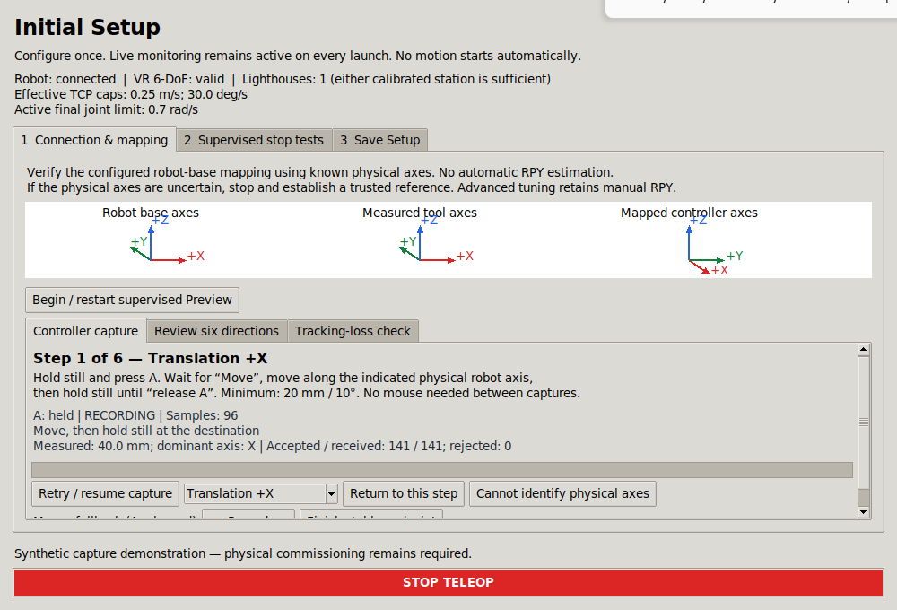
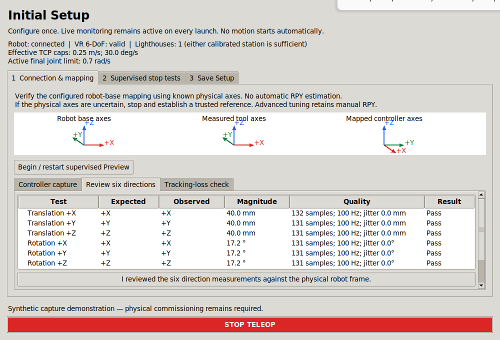
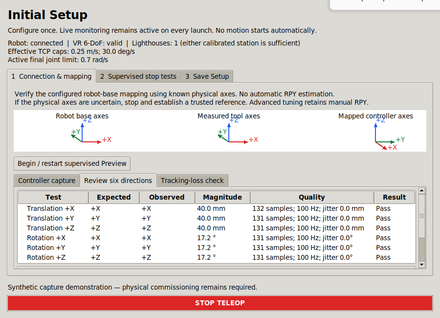
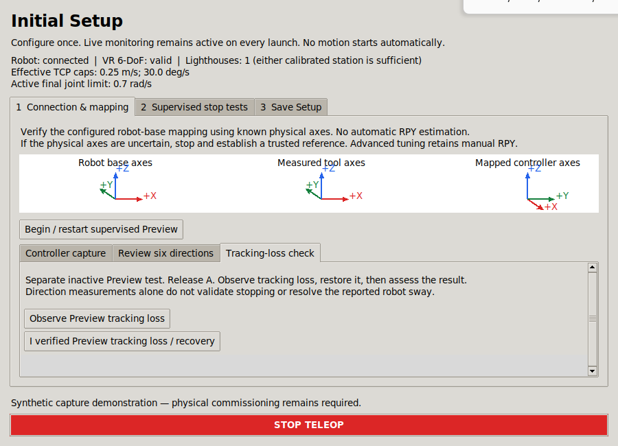

# V5.1 controller-driven Preview calibration

Implemented against clean `main` at `6f29390aaf2b13585a398e452c86388b84985210` (Add engineering evidence recording and setup checks). Implementation changes are in the working tree; no commit or physical commissioning was performed by this task.

The wizard now records six guided directions using hold A → stable start → move → stable endpoint → release A. Passing advances automatically; failures explain the cause and permit a fresh A press. One combined review confirms only six actual passed observations. Separate Preview optical-loss and supervised Live tests still determine whether Save Setup is available. No production setup record, operator preferences or libsurvive calibration was created or changed by these tests.

## Feasibility findings made before implementation

| Item | Verified source behavior |
|---|---|
| A mapping | Pinned libsurvive defines `SURVIVE_BUTTON_A = 4`; RFKnuckles decodes this button and the bridge copies ids to `Joy.buttons`. A is `buttons[4]`. |
| Joy | Existing bridge publishes 16 buttons, 12 axes and a ROS polling timestamp, frame `vr_controller`. Its tracking-loss zero buttons must not be mistaken for a completed user release. |
| Pose | Existing `/vr/controller/pose` is PoseStamped in `lighthouse`, position in metres, quaternion xyzw, with a source-derived timestamp. Only distinct accepted source poses are emitted. |
| Preview | Managed Preview generates `motion_output_enabled:=false` and an inactive motion controller. Commissioning has no final command publisher; its command gate remains disarmed. Its internal target display may report ACTIVE with A held, which is not physical motion permission. |
| Existing checks | `SetupChecks.preview()` requires A released and its manual checks cancel on lost prerequisites. This predicate was preserved; controller capture uses a separate condition. |
| Executor | GUI calls one `spin_once` per roughly 100 ms Tk poll. High-rate capture therefore needs its own node/executor thread. |
| Validity | Direct pose/optical freshness flags plus backend pose continuity, robot/joint/TF observations and controller state are available. Either calibrated Lighthouse remains sufficient for optical presence. |
| Persistence | Schema 5 supports detailed observation evidence. UI files are outside the motion-source identity. The backend telemetry-only addition needs an exact reviewed hash compatibility transition. |
| A risk | A drives the existing clutch in teleoperation. Controller capture is permitted only with independently verified Preview isolation; Live clutch, gate and protective logic must stay unchanged. |

Relevant sources: [bridge](../ur_teleop_ws/src/ur_vr_bridge/src/controller_bridge.cpp), [clutch](../ur_teleop_ws/src/ur_vr_teleop/ur_vr_teleop/tracking.py), [existing checks](../ur_teleop_ws/src/ur_vr_teleop/ur_vr_teleop/setup_checks.py), [backend](../ur_teleop_ws/src/ur_vr_teleop/ur_vr_teleop/commissioning.py).

## Isolation and execution

The observer matches the process-owner token and backend session; requires actual `motion_output_enabled=false` from status and a separate GetParameters response; checks absence of final joint-command publishers; reads ListControllers for an explicitly inactive scaled controller and no active motion-interface claimant; and requires fresh backend/controller state, false gate/enable intent, healthy tracking and robot/TF observations. The GUI additionally requires managed Preview ownership, matching configuration and no conflicting startup/settings operation. Every observed input topic must have exactly one publisher. Readback queries run only while capture is permitted.

This is an observational interlock layered on the existing Preview configuration, not a replacement for robot protective functions. Discovery and service readback have finite latency. The observer itself cannot command motion: it has no Cartesian/joint publisher, enable client or switch-controller client. Its only service clients read parameters and controller state. Existing Live controller behavior, Servo, gate, Ruckig, watchdogs, speed/acceleration/jerk ownership, frames and filtering are unchanged.

A separate SingleThreadedExecutor owns all ROS capture callbacks and the pure engine. Tk consumes cumulative snapshots through a bounded one-entry queue. A bounded eight-entry command queue fails closed on overload. Pose/Joy subscription queues are bounded; capture buffers each hold at most 3000 samples for at most 20 seconds. Shutdown joins the thread and destroys the node; reopen creates a fresh observer. No Tk widgets are accessed by observer callbacks.

## Capture state machine and analysis

The path is WAITING_FOR_PREVIEW → WAITING_FOR_TRACKING → WAITING_FOR_BUTTON_RELEASE → READY_FOR_CAPTURE → CAPTURING_START → RECORDING / WAITING_FOR_END_STABILITY → PROCESSING → PASSED → next direction or REVIEW. A failed measurement enters FAILED_RETRY. STOP/close cancels capture. A held before readiness or through a fault never starts a new capture; recovery requires release and a new press. Retry removes the selected observation and invalidates grouped review. Session/configuration changes clear capture evidence.

Stable endpoints need 250 ms and at least eight distinct source samples. Positions use median endpoint estimates; orientations use a quaternion-sign-invariant Rotation mean. Translation is `R_mapping @ (p_end - p_start)`. Rotation uses `q_end * inverse(q_start)`, converted to a world rotation vector and mapped into robot base. Positive requested-axis magnitude, dominant axis, sign and perpendicular magnitude are checked; 20 mm / 10° minima remain unchanged. Failed criteria and quality warnings are separate. Thresholds are in injectable `CaptureConfig`, documented in [Configuration](CONFIGURATION.md#v51-internal-capture-quality-thresholds), and do not affect actuator limits.

Source timestamps must increase. Duplicates never refresh freshness; out-of-order, stale, nonfinite, malformed, jump, exact-freeze and missing samples abort the attempt. The source watermark survives rejected samples. Joy uses independent ROS-header freshness and monotonic receipt timing, not assumed sensor synchrony. Button edges are debounced for 40 ms. Release captures the last stable endpoint provisionally, then waits at least 120 ms for newer valid pose and both freshness flags while isolation remains valid. A tracking-loss zero button therefore cannot produce a completed measurement. Mouse fallback uses the same samples, endpoints and isolation with A released.

## Persistence and physical references

Schema 5 is unchanged. New details include observer version, source/receipt durations, sample count/rate, stable endpoints, jitter, mapped vectors, dominant axis/sign, continuity, thresholds, failure reasons and warnings. Six Preview passes alone cannot save a setup. Existing identity, motion settings, calibration, robot, tool and full commissioning checks remain required.

`setup_source_compatibility.json` canonicalizes only the exact new observational `commissioning.py` hash to its immediately preceding reviewed hash. Arbitrary other edits do not match. A regression test loads the prior V5 identity successfully and rejects an additional source change. No broad source exclusion was introduced, and UI changes remain outside motion identity.

Free-hand controller movement has no independent knowledge of the robot-base axes: any chosen direction could be interpreted under an arbitrary alignment. The operator must use known physical robot references, verify the actual measured tool frame and apply the right-hand rule. This feature verifies the configured mapping; it neither fits nor silently applies RPY. Manual editing remains in Advanced tuning. Uncertain references block confident physical review. Direction calibration is not evidence that the reported post-movement robot sway is resolved.

## Files

New implementation:

- [calibration_capture.py](../ur_teleop_ws/src/ur_vr_teleop/ur_vr_teleop/calibration_capture.py): pure capture engine and robust analysis.
- [calibration_observer.py](../ur_teleop_ws/src/ur_vr_teleop/ur_vr_teleop/calibration_observer.py): direct subscriptions, isolation readbacks, executor and bounded mailboxes.
- [calibration_panel.py](../ur_teleop_ws/src/ur_vr_teleop/ur_vr_teleop/calibration_panel.py): guided display, scrollable fallback controls and combined review.
- [setup_source_compatibility.json](../ur_teleop_ws/src/ur_vr_teleop/ur_vr_teleop/setup_source_compatibility.json): exact observational hash transition.

Modified implementation: [setup_wizard.py](../ur_teleop_ws/src/ur_vr_teleop/ur_vr_teleop/setup_wizard.py), [gui.py](../ur_teleop_ws/src/ur_vr_teleop/ur_vr_teleop/gui.py), [dashboard_process.py](../ur_teleop_ws/src/ur_vr_teleop/ur_vr_teleop/dashboard_process.py), [commissioning.py](../ur_teleop_ws/src/ur_vr_teleop/ur_vr_teleop/commissioning.py) (three observational fields only), [engineering.py](../ur_teleop_ws/src/ur_vr_teleop/ur_vr_teleop/engineering.py), and [setup.py](../ur_teleop_ws/src/ur_vr_teleop/setup.py).

Tests: new [pure capture tests](../ur_teleop_ws/src/ur_vr_teleop/test/test_calibration_capture.py) and [ROS capture check](../ur_teleop_ws/src/ur_vr_teleop/test/calibration_ros_check.py); expanded [Tk rendering check](../ur_teleop_ws/src/ur_vr_teleop/test/gui_render_check.py). Documentation: AGENTS, Initial Setup, Architecture, Configuration, Operator Status, Commissioning, this report and its image/JSON evidence.

## Executed validation

Commands used system Python and Humble. ROS scripts ran serially with localhost-only discovery; the capture/Tk scripts explicitly initialize domain 147 and GenericSystem uses 148. No production desktop or physical driver was launched.

```bash
source /opt/ros/humble/setup.bash
colcon build --base-paths ur_teleop_ws/src --build-base ur_teleop_ws/build --install-base ur_teleop_ws/install --packages-select ur_vr_teleop
source ur_teleop_ws/install/local_setup.bash
export ROS_LOCALHOST_ONLY=1 ROS_DOMAIN_ID=147
/usr/bin/python3 -m pytest ur_teleop_ws/src/ur_vr_teleop/test ur_teleop_ws/src/ur_vr_sim_teleop/test -q
/usr/bin/python3 -m pytest ur_teleop_ws/src/ur_vr_teleop/test/test_calibration_capture.py -q
/usr/bin/python3 -m pytest ur_teleop_ws/src/ur_vr_teleop/test/ros_integration_checks.py -q
/usr/bin/python3 ur_teleop_ws/src/ur_vr_teleop/test/calibration_ros_check.py
/usr/bin/python3 ur_teleop_ws/src/ur_vr_teleop/test/gui_render_check.py
ROS_DOMAIN_ID=148 /usr/bin/python3 ur_teleop_ws/src/ur_vr_teleop/test/mock_startup_check.py
git diff --check
```

| Check | Result |
|---|---|
| Affected Humble package build | Passed, 1 package |
| Python regression directories | 326 passed; one existing xacro/Python warning |
| Final focused capture regression after fallback refinement | 50 passed |
| Explicit ROS integration suite | 86 passed |
| Capture ROS check | Passed: real Preview backend/parameter, managed command generation, direct Joy/pose capture, dropped poses, synthetic loss release, active controller and conflicting publisher refusal, cleanup/reopen |
| Tk / synthetic ROS check | Passed: grouped six-direction review, save refusal with missing optical/Live evidence, retry invalidation, STOP, close/reopen and 1000×680 / 900×650 layouts |
| GenericSystem startup | Passed: generated parameters, six joints and base-to-tool TF |
| Whitespace / Python syntax / document file links | Checked |

The [synthetic capture quality report](evidence/calibration-v51-synthetic.json) records 138 received of 138 published poses over 1.3805 s (99.97 Hz receipt throughput). The accepted +X capture used 116 samples over 1.1488 s, measured 49.998 mm, zero perpendicular displacement and no tracking dropout. Start/end position spreads were approximately 0.011 / 1.654 mm. These are synthetic transport/analysis results, not measured hardware accuracy or actual libsurvive throughput.

The affected package is Python-only. Native C++ packages and the separate Servo pipeline were not changed or rebuilt. Hardware validation remains: actual controller/button delivery and sample throughput, stable-window usability under real noise, known-reference mapping and tool axes, physical occlusion/recovery including one-station operation, and the full authorized Live stop/sway, TCP/payload and workspace assessment. No single-station cold start or physical stopping performance was demonstrated by automated tests.

## Actual Tk screenshots with synthetic inputs

The images show the real rendered wizard. Small windows have a vertical scrollbar inside each calibration panel; STOP stays outside the scrolling area.








