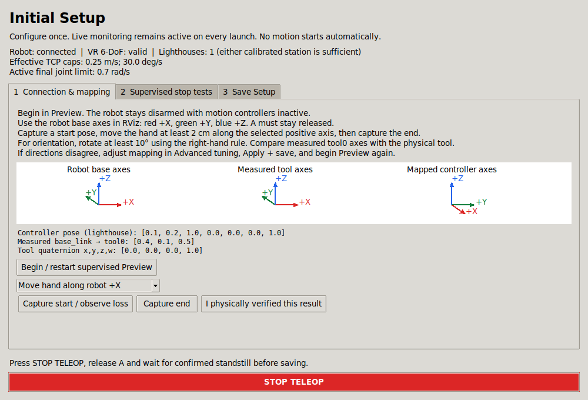
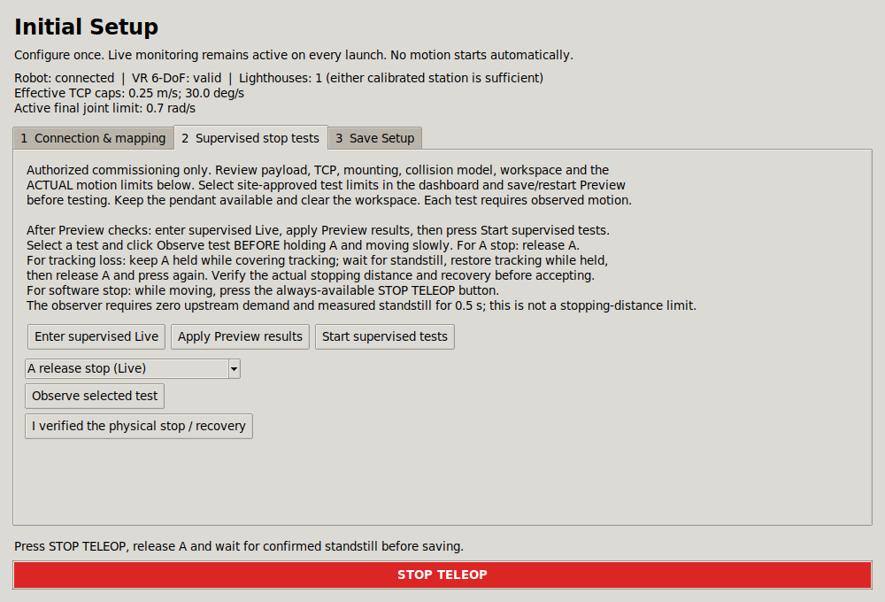
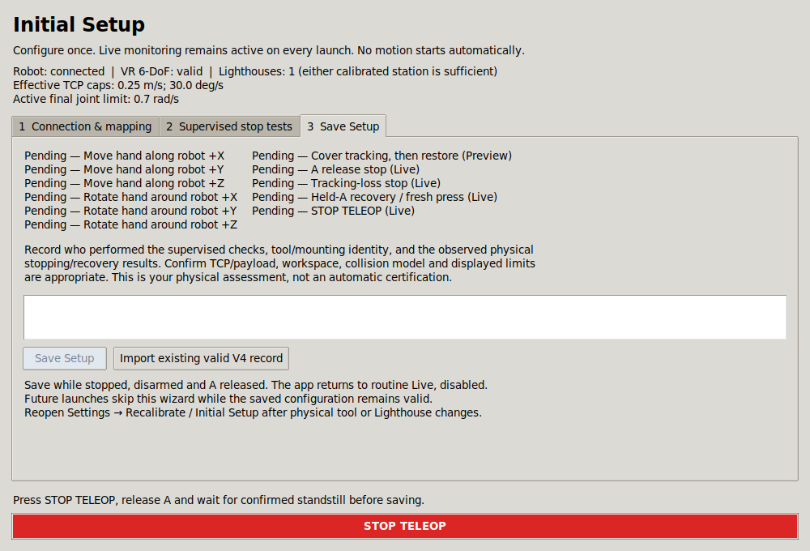
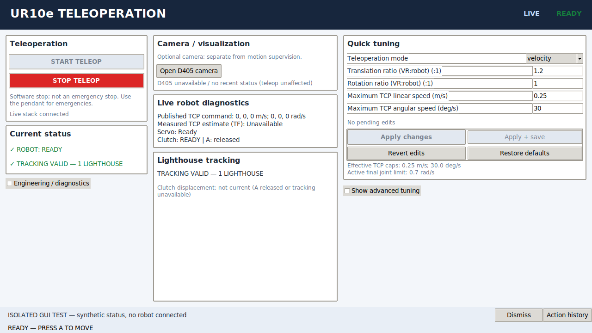

# Optional commissioning observations

Normal operation is **open application → START TELEOP → wait for READY → hold A**. Release A to stop; STOP TELEOP disarms. No wizard opens automatically. Missing `verified_setup.json`, eleven test results, expiry or signatures do not block a configured installation.

Configuration readiness means explicit, typed, internally consistent configuration, not physical certification. Validate a new/modified workcell physically before operation: robot calibration ownership, tracking mapping, tool/TCP/payload, mounting, collision model, limits and stopping/recovery. No arbitrary hand motion can establish absolute alignment.

Engineering tools retain **Optional commissioning observations** and managed Preview. This tool still records six-direction capture and supervised stopping observations if useful for site records. Opening it requests disarm. Saving historical evidence does not enable motion, and not completing it does not block ordinary Start. Its source identity and migration checks are deliberately unchanged; do not broaden old compatibility exceptions to conceal changed control code.

For the immediate development task, use [Sway diagnostics](SWAY_DIAGNOSTICS.md). No motion-control algorithm has been changed and no physical cause has been identified.

## Historical V5 procedure (superseded)

The material below preserves the earlier commissioning report. Its automatic opening, mandatory evidence, runtime record checking, session-confirmation and rollback descriptions are obsolete. Current operation is described above and in [Operation](OPERATION.md). In the retained optional tool, “Apply Preview results” retains observations locally; Start uses normal configuration/runtime readiness.

# Initial Setup Wizard

The managed application now creates its own local verified setup. First launch opens the wizard after the backend reports that no matching setup exists. An unchanged verified installation opens the ordinary dashboard: **START TELEOP → wait for READY → hold A**. No daily confirmations, external signed report, record-generation command or approval expiration date is needed.

No physical validation or valid production setup was created by this implementation. Screenshots and automated tests use synthetic telemetry; they are not robot commissioning evidence.

## One-time operator procedure

1. Open the managed application. If necessary, use **Settings → Recalibrate / Initial Setup**. Opening the wizard requests software disarm. STOP remains visible on every tab.
2. Review actual speed limits in the wizard. Choose site-approved commissioning limits in the dashboard and **Apply + save** before restarting Preview. The existing saved profile is not automatically lowered or otherwise changed by this implementation. In particular, do not assume the YAML's low defaults are the running values.
3. Select **Begin / restart supervised Preview**. This explicitly enters the existing engineering session with motion output disabled and controllers inactive. Beginning recalibration retires any previous setup into a uniquely named local backup. Canceling does not reinstate it.
4. Wait for robot state, VR valid 6-DoF tracking, measured tool TF and inactive controller readback. Either calibrated Lighthouse is sufficient; station count alone is not proof of a valid pose. Use the pendant's External Control program when requested.
5. Follow **Controller capture** through Translation +X/+Y/+Z, then Rotation +X/+Y/+Z. Identify the actual physical robot-base axes first. Hold the controller still, press and hold **A**, wait for “Move”, move at least 20 mm along the requested positive axis (or rotate at least 10° using the right-hand rule), hold still until “release A”, then release. The observer requires stable 250 ms start/end windows and continuing valid tracking after release. A passed measurement advances automatically; a failed attempt explains why and accepts a new A press after release. No mouse is needed between these six captures. Retry/return-to-step and mouse Record/Finish controls remain available; scroll the inner panel on smaller screens. These are observational thresholds, not actuator limits.
6. In **Review six directions**, inspect expected/observed axes, signs, magnitudes and tracking quality. Compare measured tool axes against the real tool and RViz. Confirm **I reviewed the six direction measurements against the physical robot frame** once. This confirms only the six genuinely passed observations. Then perform the separate **Tracking-loss check** with A released: cover tracking until valid-pose and optical-presence status are lost, restore tracking, and explicitly assess that result. If mapping/tuning changes, save/apply and restart Preview verification. If physical axes cannot be identified, use **Cannot identify physical axes** and establish a trusted reference; free-hand movements cannot determine absolute robot-base alignment. Manual RPY remains in Advanced tuning and is never changed by capture.
7. An authorized person selects **Enter supervised Live** and explicitly confirms the physical-test conditions. Review tool/TCP/payload, clear workspace, collision model and actual limits; keep the pendant available. The managed stack restarts disarmed. **Apply Preview results** submits only the checks just performed through the existing atomic parameter service. Wait for backend readback.
8. **Start supervised tests** coordinates the existing controller/Servo/enable services. It uses acknowledgments and backend readiness, and skips already-ready components. It does not command a movement: release A, then press A and deliberately make a small supervised movement.
9. Select **Observe selected test before moving**. Test A release; separately test tracking loss while A remains held. For tracking recovery, restore tracking while still holding A, verify that motion does not resume, release A, then press again and move. Finally, observe a software-stop test and press **STOP TELEOP** while moving. Repeat Start as needed after stopping. Software stop is not an emergency stop.
10. The observer requires nonzero published demand, actual measured TCP movement and advancing accepted targets before a stop. It then requires zero upstream demand and fresh measured standstill for 0.5 s. This observation window is not a maximum physical stopping time or distance. The authorized person must assess actual stopping distance, orientation, clearance and recovery, and explicitly accept each physical result. If tracking restores after A was already released, repeat the tracking-loss test to demonstrate held-button recovery inhibition.
11. Press STOP, release A, restore valid tracking and wait for fresh measured standstill. On **Save Setup**, describe who performed the tests, tool/mounting identity, actual stopping/recovery results, TCP/payload/workspace review and suitability of the displayed limits. The wizard saves settings and setup atomically per file and returns to routine Live, disarmed. Press START when ready.

The GUI has no robot authentication or role-management system; authorized supervision remains a workcell responsibility. Local file access controls protect the configuration directory. The physical assessment is a local operator record, not a cryptographic signature or certification.

## Persistence and revalidation

`verified_setup.json` is generated beside the original selected YAML (`ur_teleop/config` in the standard installation). The file has schema version 5, owner-only permissions, installation/host identity, configured robot IP and calibration digest, configured controller serial and tracking calibration digest, mapping/tool-frame/tuning identity, applicable control source/dependency/template hashes and installed Servo/Ruckig/UR package versions, selected verified mode, limit envelope, observed check results and the physical assessment. There is no enable intent. The existing validated preference writer saves tuning; legacy confirmation flags remain session-only.

Each file uses temporary-file replacement. Setup additionally fsyncs the file and directory. Preferences and setup are not a multi-file transaction: if the second write fails, setup remains invalid or mismatched and the GUI reports failure. A failure cannot create motion permission. The runtime worker validates the setup against effective parameters off the command executor. Parameter changes immediately invalidate cached readiness; stale/missing/error results fail closed.

Reverify following robot/calibration, tracking calibration, mapping, controlled tool/TCP, motion filters/tuning or motion-control software changes, raised limits, an unverified control mode, or corrupted/incompatible setup. Lower limits within the verified envelope remain allowed. GUI styling, documentation and unrelated files do not change the control identity. Each mode needs its own physical validation; a fresh wizard save approves the tested selected mode only. Import can preserve multiple previously verified V4 modes.

The configured robot identity is its selected IP and calibration, enforced alongside the existing driver calibration check. The program does not independently identify a swapped physical tool, pendant TCP/payload change or a moved Lighthouse without file changes. Reopen the wizard after these physical changes; do not reuse or import old evidence for a changed workcell. VR pairing/Lighthouse calibration itself remains the installation's libsurvive setup; the wizard verifies the existing tracking configuration rather than replacing the solver or calibrating station geometry.

## Migration from V4

Use **Import existing valid V4 record** on the Save tab while disarmed, A released, stationary and receiving fresh observations. The importer checks the old schema, workcell validation, existing report digest, unexpired legacy approval, installation/robot/calibration/tracking/tuning identity, approved modes and limits. It compares motion-related source hashes; only the exact reviewed original-to-new workflow transition in `setup_migration.json` is accepted as a migration. Other changed control code requires new physical checks. UI-only changes are excluded.

Successful import creates the new local setup and retains the old file. The new setup has no future report/expiry dependency. Invalid, expired, unavailable or mismatched legacy evidence is not silently approved: complete the wizard instead. The legacy CLI remains available for old tooling, but writing a legacy record does not itself enable routine operation; import it through the GUI. There is no need to prepare JSON manually.

## Protections and compatibility

The production chain remains bridge → TrackingClutch/Commissioning → Servo → timestamp relay → Gate → native scaled controller → UR driver. No new motion publisher, direct robot command, control loop or limit was introduced. Velocity/position behavior, Lighthouse estimation, Servo collision/singularity handling, Ruckig, servoj tuning, protective stop logic and command watchdogs are unchanged.

Fresh valid continuous pose, live robot/safety state, TF/joints, exclusive controller ownership, native limits, Servo readiness, source ages, operator heartbeat and A-button clutch still govern readiness independently of saved setup. STOP retires startup requests and withholds heartbeat. An uncertain enable outcome still requires a new backend session. Tracking recovery still requires release and a fresh A press. Routine startup never supplies legacy confirmation flags to replace a missing setup.

Expert diagnostics, managed Preview, explicit `--engineering-session`, and the separate mock simulator remain available. New observational status fields are documented in [Operator status](OPERATOR_STATUS.md#initial-setup-additions). User-facing setup errors avoid raw filesystem exceptions; the technical detail is in Advanced Diagnostics.

## Original V5 validation and screenshots

For the current controller-driven workflow, see the [V5.1 implementation and validation report](CALIBRATION_V51.md), including current screenshots, sample quality evidence and test results. The following results and images describe the preceding V5 release.

Actual executed commands and final results are recorded below. All ROS tests were isolated to localhost with synthetic state; no production desktop, physical driver connection or automatic robot motion was run.

```bash
export PATH=/usr/bin:/bin:/usr/sbin:/sbin
source /opt/ros/humble/setup.bash
cd ur_teleop_ws
colcon build --base-paths src --packages-select ur_vr_teleop
source install/local_setup.bash
cd ..
export ROS_LOCALHOST_ONLY=1 ROS_DOMAIN_ID=147
/usr/bin/python3 -m pytest ur_teleop_ws/src/ur_vr_teleop/test ur_teleop_ws/src/ur_vr_sim_teleop/test -q
/usr/bin/python3 -m pytest ur_teleop_ws/src/ur_vr_teleop/test/ros_integration_checks.py -q
/usr/bin/python3 ur_teleop_ws/src/ur_vr_teleop/test/gui_render_check.py
/usr/bin/python3 ur_teleop_ws/src/ur_vr_teleop/test/mock_startup_check.py
```

| Check | Final result |
|---|---|
| Humble `ur_vr_teleop` package build | 1 package built successfully |
| Python regression directories | 276 passed; one existing xacro/Python compatibility warning |
| Explicit ROS integration suite | 86 passed |
| Real Tk / synthetic ROS GUI check | Passed; three dashboard sizes and three wizard tabs, including STOP visibility |
| GenericSystem startup check | Passed; generated parameters, six joints and base-to-tool TF |
| Python syntax, reviewed migration hashes, local Markdown targets, Git whitespace | Passed |

Earlier development runs caught and resolved an installed-overlay import issue, GUI shutdown compatibility and wizard footer layout. An overlapping preliminary ROS/Tk run emitted a service-response timeout warning; the final serial runs passed without it.

The Tk test explicitly initializes ROS context 147; the mock startup script independently uses localhost 148 and GenericSystem. They were also run serially for final verification. Tests cover first launch, valid-restart suppression, atomic saving/rejection, corruption and relevant-change invalidation, UI-change stability, migration, observed stop/fresh-clutch sequences, source/pose faults, one-button idempotency and cancellation, process-owner serialization and STOP visibility.

The affected package is Python-only and was rebuilt against the installed Humble workspace. Native C++ packages and the separate Servo pipeline were not changed or rebuilt for this task. Physical occlusion geometry, one-station cold start, tool/mounting accuracy, payload/TCP, stopping distance at the installation's chosen limits and supervised full wizard commissioning remain hardware validation items. Tests never write a valid production setup.

Screenshots are actual Tk rendering with **synthetic telemetry** and pending physical checks:








