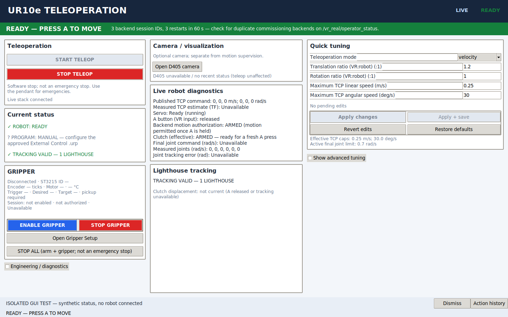

# V6 — independent gripper, Dashboard program start and ordered shutdown

> **Oscillation-status note:** the later Servo position-history correction and operator-reported outcome are described in [Sway diagnostics](SWAY_DIAGNOSTICS.md). The unresolved statement at the end reflects the state at the time of this report.

> **Superseded for concurrency/lifecycle behavior by [V6.1 stabilization](V6_1_STABILIZATION_REPORT.md).** The V6 feature description remains useful; V6.1 changes stop priority, shared tracking retention, program identity and continuous verification.

Date: 2026-10-19

## Analyzed revision

- Branch: `main`
- Commit: `24ec1ad92c939186af9925d6e626d5aa7e9d2c71`
- Working tree was clean before these changes.

## Gate 0 audit findings

1. **Gripper ROS/process dependencies.** `ur_bus_servo_gripper` was an optional child started by `desktop.ProcessManager`. `gripper_worker` authorized follow from `/vr_real/operator_status` fields `enable_requested`, `motion_ready` and `motion_output_enabled`, plus `/vr_real/operator_present`.
2. **ST3215 connection paths.** `connect`/`reload` required `stationary_disarmed()` (fresh UR joints, disarmed, A released). Auto-connect fired only after a fresh backend status satisfied that condition. Device/SDK/permission errors were exposed as raw exception text.
3. **Gripper authorization.** Follow required the arm backend, A-independent but arm-enable-dependent, and had no independent session latch.
4. **Trigger mapping.** `Joy.axes[1]` was normalized by `normalize()`; release maps to `trigger_min` → OPEN endpoint and press to `trigger_max` → CLOSED endpoint, with optional inversion and endpoint deadzones.
5. **Dashboard services.** Installed Humble interfaces were confirmed: `IsInRemoteControl`, `GetSafetyMode`, `GetRobotMode`, `GetLoadedProgram`, `Load`, `IsProgramRunning`, `Trigger` for Play/Stop.
6. **Startup dependencies.** `startup.py` waited for `robot_preparation_ready`, which required the pendant-run External Control program. It had no Dashboard program-start stages.
7. **Shutdown ordering.** `ProcessManager.stop()` sent SIGINT to tagged process groups directly; no Dashboard Stop was requested. Any critical child failure called `stop()` for the whole stack, including the gripper.
8. **Test coverage.** Existing tests covered gripper mapping, pickup, serial transport, GUI behavior, startup and process ownership. There were no independent-session, Dashboard program-start or shutdown-order tests.

## Implementation summary

### Independent gripper

- `/gripper/set_enabled` (`std_srvs/SetBool`) latches a session permission. It is never inherited from `gripper.json` after a restart.
- Normal follow requires: latched session enable, calibrated/enabled profile, fresh feedback, healthy motor, fresh Joy/pose/optical, gripper heartbeat `/gripper/operator_present`, and deliberate pickup. It never reads arm `enable_requested`, `motion_ready`, `motion_output_enabled`, armed state, A, Servo, controller ownership or External Control.
- Connect/read/save and auto-connect are robot-independent. `stationary_disarmed()` remains for the arm only. Physical calibration motion requires explicit gripper consent and never fabricates arm feedback.
- STOP GRIPPER withdraws targets/pickup and retains the last bounded hold target. STOP ALL withdraws arm and gripper permission. Closing the GUI withdraws the gripper heartbeat and requests disable.
- Specific diagnostics: missing SDK, USB adapter not found, multiple adapters, permission denied, port busy, no/multiple servo IDs, wrong mode, missing calibration, stale feedback, stale pose/optical/trigger, heartbeat missing, duplicate node/owner.
- The main GRIPPER card exposes connection, servo ID, encoder, motor state, trigger/desired values, session/authorization, ENABLE, STOP, Setup and STOP ALL.
- An arm/driver/tracking failure now stops only those process groups; the gripper child keeps its serial ownership. Full Stop ROS/close terminates it.

### Dashboard program start

- `program_control.py` implements a pure state machine: Remote Control → safety mode → robot mode → loaded program → running readback → load/play as needed → Dashboard program-running → fresh driver readiness.
- `program_panel.py` selects/verifies the approved `.urp`; the override is `program_control.json` beside the selected YAML.
- `gui.py` calls the services asynchronously and never from the Tk render loop.
- A Play acknowledgment is never READY. Late replies after STOP are discarded with a generation check.
- The app never changes Remote Control, resets safety, releases brakes, powers the robot or executes URScript. `headless_mode:=false` is unchanged.

### Ordered shutdown

- `dashboard_services.py` requests `/dashboard_client/program_running`, calls `/dashboard_client/stop` only when needed, and requires false readback. An acknowledgment alone is not success.
- `ProcessManager.stop()` invokes the bounded Dashboard stop before signaling the driver; failure/timeout is reported and bounded termination still proceeds.
- STOP TELEOP only disarms the arm; STOP GRIPPER only withdraws gripper follow; Close/Stop ROS coordinate both.

## Files changed

- `ur_bus_servo_gripper/gripper_node.py`, `gripper_worker.py`, `st3215_driver.py`
- `ur_vr_teleop/program_control.py`, `dashboard_services.py`, `program_panel.py`
- `ur_vr_teleop/gui.py`, `gripper_panel.py`, `desktop.py`
- `ur_teleop/config/real_teleop.yaml`
- Tests: `test_gripper.py`, `ros_gripper_check.py`, `test_program_control.py`, `program_dashboard_check.py`, `test_desktop.py`, `test_gripper_gui.py`
- Docs: `README.md`, `AGENTS.md`, `docs/{GRIPPER,OPERATION,CONFIGURATION,ARCHITECTURE,COMMISSIONING,TROUBLESHOOTING}.md`

The screenshot is from the isolated synthetic GUI render check, not a live robot session. It shows the program state row, gripper diagnostics, ENABLE/STOP/STOP ALL controls and the existing arm controls.

## Commands and results actually executed

| Command | Result |
|---|---|
| `colcon build --symlink-install --packages-select ur_bus_servo_gripper ur_vr_teleop` | Both packages finished; no build errors |
| `pytest ur_teleop_ws/src/ur_vr_teleop/test ur_teleop_ws/src/ur_bus_servo_gripper/test ur_teleop_ws/src/ur_vr_sim_teleop/test -q` | **485 passed**, 1 existing warning |
| `ros_gripper_check.py` (domain 147) | Passed: independent enable, pickup, loss, recovery, stale stamps, STOP; no arm publisher |
| `ros_integration_checks.py` (domain 147) | Exit 0 |
| `program_dashboard_check.py` (domain 147) | Passed: mocked Dashboard start/refusal/readback and confirmed shutdown |
| `calibration_ros_check.py` (domain 147) | Passed: Preview capture, isolation, cleanup |
| `gui_render_check.py` (domain 43) | Passed: three layouts and existing GUI workflows |
| `mock_startup_check.py` (domain 147) | Passed: generated parameters, GenericSystem, joints, tool0 TF |

Not executed: C++ bridge/native-controller CTest suites (packages untouched), `servo_pipeline_check.py` (Servo/relay untouched), and all physical-robot/gripper tests.

## Gate status

| Gate | Status |
|---|---|
| 0 source audit | PASS |
| 1 gripper acceptance (automated) | PASS |
| 2 remote start acceptance (automated) | PASS |
| 3 shutdown acceptance (automated) | PASS |
| 4 combined integration (automated) | PASS for mocked/read-only paths; physical scenarios PENDING |
| 5 ROS build and regression | PASS for the commands above |
| 6 supervised hardware validation | **PENDING** — no physical gripper or robot motion was performed |

## Remaining hardware validation

See [Commissioning V6 checklist](COMMISSIONING.md#v6-hardware-validation-checklist-pending-unless-actually-performed). In particular:

- Real ST3215 ID/firmware/travel, trigger endpoints, USB fault/reconnect, holding behavior.
- Real Remote Control/approved `.urp`, Dashboard Play, reverse-interface connection, no unintended motion, program stop before shutdown.
- At the time of this report, the previously reported UR10e wrist/arm oscillation remained unresolved; this work did not claim otherwise. The later Servo correction and operator-reported outcome are documented separately, as noted above.

## Known limitations

- A Dashboard Stop request already received by the server cannot be revoked locally; an in-flight Play can still start the robot program. Arm enable is never sent, and the managed stack is stopped in order.
- If the driver has already crashed, graceful program stop cannot be confirmed; the report says so and bounded termination proceeds.
- Soft-stop behavior, motor holding torque and safe grasp are not guaranteed by software tests.
- The saved `gripper.json` `enabled` flag only makes the profile available; it never reauthorizes movement after restart.

## Rollback

1. Revert this change set with Git (or restore the listed files from the pre-change commit).
2. Rebuild `ur_bus_servo_gripper` and `ur_vr_teleop` with `colcon build --symlink-install --packages-select ...`.
3. Remove `program_control.json` if the old manual-pendant workflow is required.
4. Do not delete `gripper.json` or `~/.config/libsurvive/config.json`; preserve physical calibration and robot alignment.
